# World Models v2: A Third Tool, Detailed Prompts, and an Attempt at a Game

Eric Zhang · AI for Creatives · 12 November 2026

This is a second version of the project. The first version (`world-models-writeup.md`) is unchanged. All tests in this file were run on 12 November with Claude (an AI assistant) driving the browser, signed out of every tool. Nothing was paid for.

## What is new in v2

1. **A third tool.** Odyssey, a real-time world model that runs in the browser with no account.
2. **Prompting experiments.** A 5-word prompt against an 80-word prompt, and typed prompts sent in the middle of play.
3. **An attempt at a game.** One first-person-shooter scene and one role-playing scene, each played and judged against what a game needs.
4. **A working game.** A small first-person shooter in the `v2-game` folder that uses a world-model scene as its level and ordinary code for its rules.
5. **A survey of paid options**, with prices checked on the vendors' own pages where possible.

## The question

Version 1 asked whether these tools keep a consistent world. Version 2 asks a harder question: **can a world model give you a game?** A game needs three things:

- **A world that stays put** (state).
- **A world that reacts to you** (dynamics).
- **Rules:** health, ammunition, score, a way to win or lose.

## Tools

| Tool | What it is | Cost | Used in v2? |
| --- | --- | --- | --- |
| **Odyssey** (`experience.odyssey.systems`) | Real-time playable video from a text or image prompt | Free, no sign-in. A 5-minute countdown runs at the top of the page. | Yes, 4 worlds |
| **Marble** (World Labs) | 3D scene (Gaussian splat) from a prompt | Free: 4 worlds, no export. Standard $20/month: 12 worlds, splat and collider-mesh export. Pro $35. Max $95. | Re-used the v1 library world |
| **Waypoint** (Overworld Stream) | Real-time playable video | Free with sign-in | No. Needs an account, and v1 results stand. |
| **Project Genie** (Google) | Real-time playable worlds | Google AI Ultra subscribers, 18 and over. Press reports give conflicting prices ($200/month in the most recent one) and a 60-second session cap. | No. Paid. |
| **Mirage 2** (Dynamics Lab) | Real-time playable worlds | Reported free in 2025 | No. The demo address would not load. |
| **Decart Oasis** | Real-time video-to-video | Reported as pay-per-second through an API. Price not confirmed. | No |

The Odyssey home page has a "Try Odyssey-3" button that leads to the site I used, so the model is probably Odyssey-3. The page does not say so directly.

## Experiment 1: the library prompt in a third tool

I gave Odyssey the exact library prompt from v1 (mirror, staircase, balcony, "SILENCE PLEASE" sign above a doorway). The world was playable about 25 seconds later.

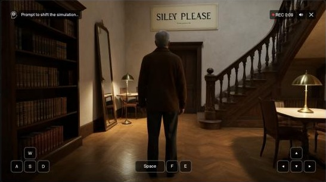

The first frame has the standing mirror, the staircase, the doorway and the sign. It also has a man seen from behind, who was not in the prompt. Odyssey's view setting was left on "Third-Person View," so every world gets a character to follow.

| | Marble | Waypoint | Odyssey |
| --- | --- | --- | --- |
| Time to a usable world | Several minutes | Under 30 seconds | About 25 seconds |
| Sign text | "PKE ENNCE" | "SILENCE" then a garbled word | "SILEY PLEASE" |
| Walk through the doorway | Camera passes through a solid door into black, empty space | Not tested | The man walks through into a **new room** the model invents on the spot |
| Turn away and turn back | Identical | Changed completely (v1, no recording) | Changed completely |

The doorway result is the clearest difference between the two kinds of tool. Marble has nothing behind the door because nothing was stored there. Odyssey has no stored scene at all, so it makes up a second library room, complete with its own unreadable sign.

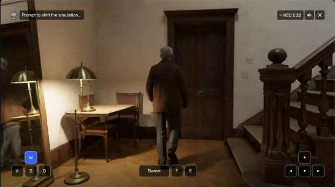
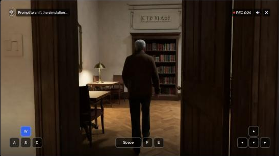

Then I held the left arrow for 3 seconds and the right arrow for 3 seconds. That should bring the view back to where it started. It did not. The room is different, the mirror is now a framed mirror on the wall, and the man faces the camera.

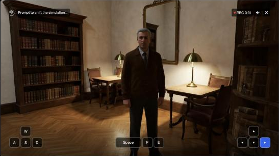

## Experiment 2: short prompt against detailed prompt

**Short prompt (5 words):** `zombie shooter in a library`

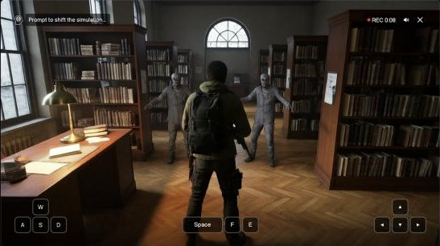

**Detailed prompt (about 80 words):**

> First-person shooter view inside an abandoned old library at night. The player's two hands hold a pump-action shotgun at the bottom center of the frame. Tall wooden bookshelves form narrow aisles, a wooden staircase leads up to a balcony, warm lamplight, dust in the air. A slow shambling zombie in a torn librarian's cardigan walks toward the player down the center aisle. The player walks forward, aims and fires; muzzle flash, the zombie staggers.

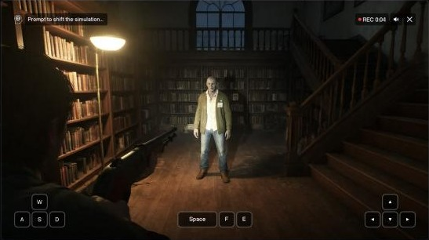

| Choice | Short prompt | Detailed prompt |
| --- | --- | --- |
| Time of day | Model chose daylight | Night, as asked |
| Weapon | Model chose a pistol | Shotgun, as asked |
| Enemies | Two generic grey zombies | One man in a cardigan with a name badge, as asked |
| Staircase and balcony | None | Both present |
| Lamplight | A desk lamp | A floor lamp lighting the aisle |
| First-person view | No | **No.** Over-the-shoulder, despite the prompt |

What I take from this:

- **Anything you leave out, the model fills in with the most generic choice.** The short prompt produced a stock "zombie game" image.
- **Concrete nouns land.** The cardigan, the shotgun, the staircase and the lamp all appeared.
- **A setting can outrank the prompt.** I asked for first-person and got third-person, because the site's view toggle was on Third-Person View. Check the tool's settings before blaming the prompt.
- **Actions in the opening prompt are not carried out.** "Aims and fires; muzzle flash" did not happen by itself. The opening prompt sets the scene. It does not script events.

## Experiment 3: the first-person-shooter attempt

Controls shown on screen: W, A, S, D, Space, F, E and the arrow keys, plus a text box labelled "Prompt to shift the simulation."

| Step | What I did | What happened |
| --- | --- | --- |
| 1 | Held W for 2 seconds, pressed F | The player walked toward the man. The shotgun vanished, the player's jacket changed from dark to light, and the lamp disappeared. |
| 2 | Held left arrow 2.5 seconds | The shotgun came back, now pointed at the man at close range. |
| 3 | Held right arrow 2.5 seconds | Not the starting view. The staircase and window were gone. |
| 4 | Pressed Space | No visible effect. |
| 5 | Typed: "The player fires the shotgun with a bright muzzle flash and the zombie is knocked backward onto the floor" | About 6 seconds later the man was lying on the floor. The view had jumped back to something close to the opening shot, staircase included. |

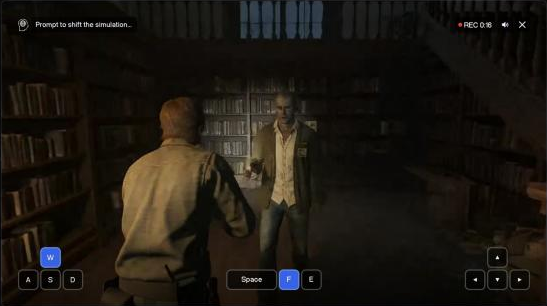
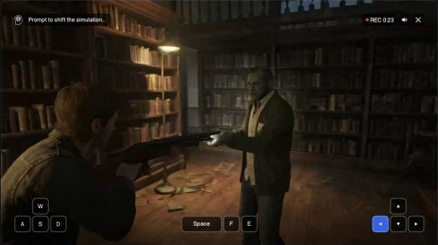
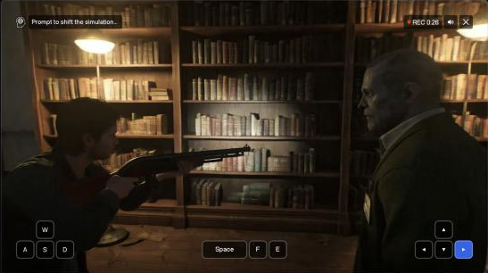
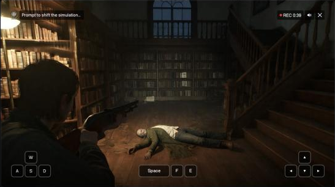

No key fired the gun. The only way to "shoot" the zombie was to type that it had been shot.

## Experiment 4: the role-playing-game attempt

**Prompt:**

> Third-person fantasy RPG. The camera follows behind a knight in dented steel armor with a red cloak and a sword on his back, walking through a medieval market village at golden hour. Timber houses, market stalls with fruit and potions, chickens, a stone well. Ahead, a hooded merchant with a glowing blue lantern waits beside a wooden signpost reading INN. The knight walks up to the merchant and talks to him.

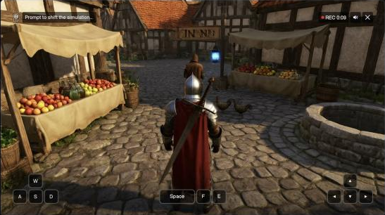

The first frame contains nearly everything in the prompt: the knight, the red cloak, the sword, the timber houses, the fruit stalls, the chickens, the well, the hooded figure and the blue lantern. The sign reads roughly "IN NN."

| Step | What I did | What happened |
| --- | --- | --- |
| 1 | Held W for 3 seconds | The knight walked up to the merchant. The sign changed to something like "IN8N8." |
| 2 | Pressed E | The merchant vanished. The knight was now holding a red object. The sign had grown to fill a wall, and the lantern sat on the ground. No dialogue appeared. |
| 3 | Typed: "A fire-breathing dragon lands in the village square and the knight draws his sword to fight it" | A dragon breathing fire appeared within about 5 seconds. The village had snapped back to its opening layout. |
| 4 | Pressed F | The knight lunged toward the dragon. |

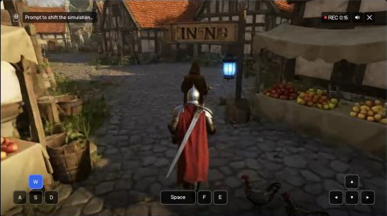
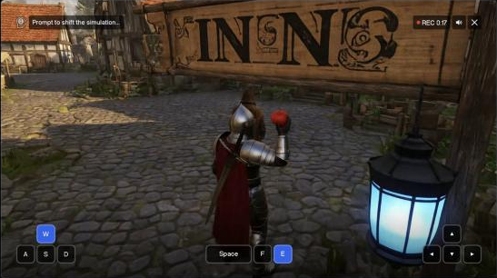
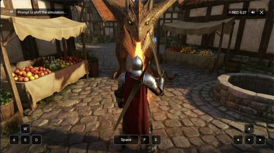
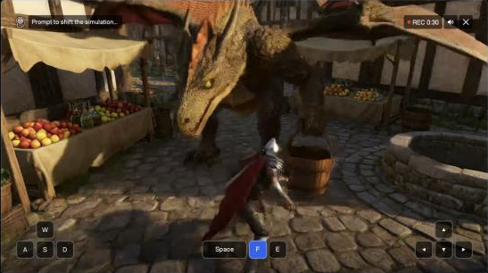

In both games, a typed event prompt pulled the scene back toward the opening frame. My guess is that the model treats the first frame as an anchor when it receives new text. I could not confirm this.

## Is it a game?

| What a game needs | Shooter attempt | RPG attempt |
| --- | --- | --- |
| Looks like the genre | Yes | Yes |
| Movement keys respond | Yes | Yes |
| Action keys do the same thing each time | No. Space did nothing visible. | No. E made the merchant vanish. |
| Enemy reacts to an attack | Only when I typed it | Not tested |
| Health, ammunition, score, inventory | None | None |
| A way to win or lose | None | None |
| A map that stays the same | No | No |
| Can save and come back | No | No |

**Verdict: not a game. It is an interactive video in the style of a game.** The look, the camera and the movement are convincing for a few seconds at a time. What is missing is everything a game engine keeps track of. Nothing counts the shells in the shotgun. Nothing remembers that the merchant exists once he leaves the frame. When I typed that the zombie fell, it fell, which means I was acting as the rule book.

This extends the v1 conclusion:

| | Keeps the world (state) | Reacts to you (dynamics) | Has rules |
| --- | --- | --- | --- |
| Marble | Yes | No | No |
| Waypoint, Odyssey | No | Yes | No |
| A real game | Yes | Yes | Yes |

## The game: Last Shift at the Library

Since a world model alone did not give me a game, I split the job. The world model makes the place. Ordinary code makes the rules. The result is in the `v2-game` folder.

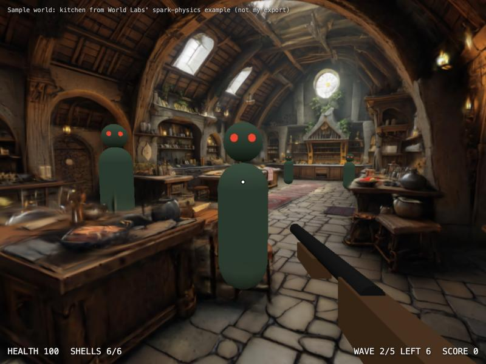

**What it is.** A first-person wave shooter that runs in a browser. You have 100 health and a six-shell shotgun. Enemies walk at you and hit you when they reach you. Clear five waves to win. Reach zero health and you lose.

**How it uses a world model.** Marble can export two files for one world:

- a **Gaussian splat**, which is the picture, and
- a **collider mesh**, a rough invisible shape of the floors, walls and furniture.

The game draws the splat and tests every movement and every shot against the collider. That one extra file fixes the three Marble failures from v1: the door is now solid, the floor holds you up, and steps under about 45 cm can be climbed.

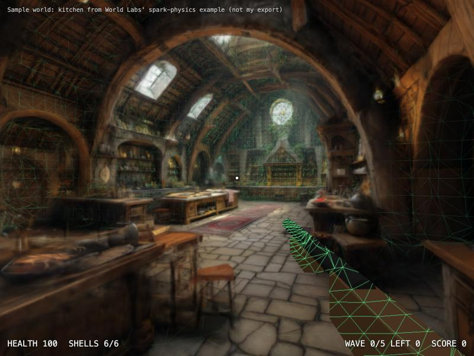

**The scene in these screenshots is not mine.** Exporting from Marble needs the $20 Standard plan, which I have not bought. So the game currently loads a sample kitchen scene that World Labs published with its `spark-physics` example. The game looks for `v2-game/assets/world.spz` and `v2-game/assets/collider.glb` first, and uses the sample only if they are missing.

**To run it:**

```bash
python3 -m http.server 8123 --directory v2-game
```

Then open `http://localhost:8123`. Controls: W A S D to move, mouse or arrow keys to look, click or F to shoot, R to reload, Space to jump, C to show the collider.

**To put my own world in it:**

1. Subscribe to Marble Standard for one month ($20).
2. Generate an enclosed arena with the prompt below. The v1 doorway test showed there is nothing outside a generated room, so the level should have no exits.
3. From the world's download menu, export the splat and the collider mesh.
4. Save them as `v2-game/assets/world.spz` and `v2-game/assets/collider.glb` and reload the page.
5. Press C. If the green wireframe does not sit on the picture, change the two `Flip` lines at the top of `main.js`.

**Arena prompt (ready to paste into Marble):**

> A single enclosed circular library hall with no doors and no windows at floor level. Stone floor, completely flat and clear of furniture in the center. Eight tall wooden bookshelves stand around the edge like pillars, with wide gaps between them for cover. A balcony runs all the way around the upper level, reached by nothing. Four brass lamps on the walls give warm, even light. No mirrors, no signs, no text anywhere.

The last line is deliberate. Mirrors and signs are things v1 showed Marble gets wrong, so the arena avoids them.

**How it was tested.** The embedded browser I used pauses animation when idle, so the game loop was stepped by script at 60 steps per second.

| Check | Result |
| --- | --- |
| Walk forward 1 second | Moved 3.5 m, as designed |
| Walk in a straight line for 15 seconds, in each of 8 directions | Stayed inside the room every time and never fell |
| Jump | Left the floor and landed back on it |
| Stand still with enemies nearby | Health fell to 0, "You died" screen |
| Scripted player that aims at the nearest enemy and fires | Cleared all 5 waves in 72 seconds of game time: 40 enemies, 40 shots, score 4000, 92 health left, "You survived the night" screen |
| Enemy behind a splat table | Drawn partly hidden by the table |

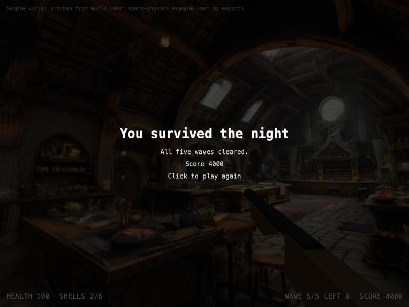

**The v1 lesson showed up again.** In the first movement test the player walked to the far end of the kitchen and fell out of the world. The sample's collider has no floor behind an archway there, although the picture shows a room continuing. It is the same finding as the Marble doorway test: what looks like more world is only a picture of it. The fix was a rule that refuses any step with no floor under it.

**Checked against the same list as before:**

| What a game needs | Odyssey attempts | Last Shift at the Library |
| --- | --- | --- |
| Movement keys respond | Yes | Yes |
| Action keys do the same thing each time | No | Yes |
| Enemy reacts to an attack | Only when typed | Yes. Four pellets to the body, or two to the head |
| Health, ammunition, score | None | All three |
| A way to win or lose | None | Both |
| A map that stays the same | No | Yes |
| The world looks AI-generated | Yes | Yes for the room. No for the enemies, which are plain shapes. |

**What it still lacks.** The player can walk up onto low furniture, because anything under 45 cm counts as a step. The enemies are capsules with red eyes, not generated characters. They walk in a straight line at the player, so furniture can block them. One that makes no progress for 6 seconds is moved somewhere else. There is one weapon and one level.

**Other routes not taken.** Project Genie needs a Google AI Ultra subscription. It would still have no rules, and press reports say sessions are capped at 60 seconds, so I expect the same verdict as Odyssey.

## A prompt template

Built from what worked above. One line per item, in this order:

1. **Camera:** first-person or third-person, and what is at the bottom of the frame.
2. **Player:** clothing and what they hold.
3. **Place:** three to five concrete objects, named.
4. **Light and time of day.**
5. **Other characters:** who, wearing what, standing where.
6. **Avoid:** readable text longer than one word.

Leave actions out of the opening prompt. Send them as typed event prompts during play, one event at a time.

## Limits

- **One run per prompt.** These models give a different result each time, so each row above is one sample.
- **Short sessions.** Everything in Odyssey was done inside one 5-minute countdown. I did not see what happens when it reaches zero.
- **Scripted keys.** Keys were pressed by sending key events from the page, held for a set time. A person with a real keyboard and mouse may get somewhat different behaviour.
- **Small screenshots.** The Odyssey frames are about 550 pixels wide.
- **View setting not varied.** Odyssey's Third-Person View toggle was left on, so a true first-person shooter was not tested.
- **Mirror not tested in Odyssey.**
- **The short-prompt world was not played,** only its first frame was compared.
- **Session addresses:** each world got its own address while it ran (shooter `/HnVXR9tqoQ`, RPG `/ZibBrxBLdx`, short prompt `/yNgJIJaNzY`, library `/ytcs6WGLC8`, all under `experience.odyssey.systems`). I did not check whether they work as share links.
- **Prices change.** The Marble prices were read from its pricing page on 12 November 2026. The Genie price comes from news reports that disagree with each other.
- **The game runs on a sample scene, not my own world.** The steps for swapping in a Marble export are untested because no export was bought. The orientation settings were worked out on the sample and may need changing for a new export.
- **The game was tested by script, not by hand.** Mouse look could not be tested, because the embedded browser refused to lock the pointer. The arrow keys were used to look instead.
- **The game needs an internet connection.** It loads its libraries, and the sample scene (about 8 MB), from the web.

## Sources

- [Odyssey](https://odyssey.systems/) and the [Odyssey experience site](https://experience.odyssey.systems/)
- [Marble pricing](https://marble.worldlabs.ai/pricing)
- [World Labs docs: mesh export](https://docs.worldlabs.ai/marble/export/mesh.md)
- [World Labs docs: interactive world examples](https://docs.worldlabs.ai/api/interactive-world-examples.md)
- [Spark physics example](https://github.com/bmild/spark-physics) (MIT licence; source of the sample kitchen scene)
- [Spark, World Labs' splat renderer for three.js](https://sparkjs.dev/docs/)
- [Gaussian Splat Character Controller](https://github.com/icurtis1/gaussian-splat-character-controller)
- [Google Labs: Project Genie](https://labs.google/projectgenie)
- [Engadget: the Google AI Ultra plan now starts at $100 a month](https://engadget.com/2176060/the-google-ai-ultra-plan-now-starts-at-100-a-month)
- [The Decoder: Mirage 2](https://the-decoder.com/mirage-2-allows-users-to-turn-sketches-and-photos-into-interactive-game-worlds/)
- Version 1 of this project: `world-models-writeup.md` and `world-models-documentation.md`
