# World Models Project: Documentation

Session date: 2026-11-02. Assignment due: 2026-11-03.

This file records what was set up and run, so the results can be reproduced and written up. The plan and tool research are in `world-models-plan.md`.

## Goal
Compare an **explorable** world model (Marble) with a **playable** one (Overworld Waypoint), see where each fails, and note what is good.

## Setup

### Accounts
| Tool | Account | Plan | Notes |
|---|---|---|---|
| Marble (`marble.worldlabs.ai`) | Created by the user in Chrome | Free, 7,000 credits | Sign-in options: Google, GitHub, email |
| Overworld Stream (`overworld.stream`) | Created by the user in Chrome | Free | Sign-in options: Discord, GitHub, Google, passkey, email |

The user entered all login details. Claude only opened the pages and navigated.

### Hardware and software
- Mac (Chrome with the Claude extension): used for Marble and Overworld Stream in the browser.
- RTX 4080 Super PC: to run Biome (the local Waypoint app). The Windows installer, Biome 1.1.1 (EXE, about 124.5 MB), is offered at `over.world/install`. It has not been downloaded or run yet.
- Biome has no macOS client yet ("coming soon").

## What was found while exploring

### Marble
- The create box has two tabs: **2D input** (text, image, video, panorama) and **3D input** (beta).
- Model menu: Marble 1.1 Plus ("best for large scenes"), Marble 1.1 ("improved quality", default), Marble 1.0 (legacy), Marble 1.0 Draft ("quickly explore ideas").
- **Draft is locked on the Free plan.** Selecting it opens an upgrade prompt for the $20/mo Standard plan. Nothing was purchased.
- Free plan cannot export. Splat export, collider meshes and Draft start at Standard.
- Marble rewrites a short prompt into a long scene description, which shows on each world card. The world follows that rewrite, not only the original words.

### Overworld Stream (Waypoint)
- 19 public worlds, plus a "Yours" tab.
- **Make World** (press M) takes a text prompt ("What do you want to play?") and has a Generate button. No image upload was visible.
- Nearly every public thumbnail shows a held weapon, so the playable worlds may lean toward shooter-style framing. Not yet confirmed.
- Pause menu: Resume, Worlds, Settings, Link Discord, Sign out.

## Marble worlds generated
All four used **text input** and the **Marble 1.1** model on the Free plan. Expected cost: 1,500 (generation) + 80 (text input) = 1,580 credits each.

| # | Prompt | Marble title | World ID | Matching Waypoint scene |
|---|---|---|---|---|
| 1 | A misty medieval stone castle keep on a small island in a calm lake at dawn, grey stone walls, low fog over the water, pine-covered hills in the distance, a wooden dock in the foreground, soft cool morning light, photorealistic | Misty Medieval Castle Dawn | dfaf87c7 | Mistveil Keep |
| 2 | The bridge of a sci-fi starship interior, curved command consoles with glowing blue displays, a large panoramic viewport showing a colorful nebula, a central captain's chair, metal floor with light strips, clean futuristic design | Sci-Fi Starship Bridge Nebula | 5aa6c2ed | Starship Bridge |
| 3 | An overgrown ruined city at sunset, collapsed skyscrapers covered in vines and moss, a cracked street in the foreground with wildflowers growing through the asphalt, abandoned cars, warm golden light through the buildings, atmospheric haze | Overgrown Ruined City Sunset | ba36e1ad | Skyline Graveyard |
| 4 | A quiet old library room with a tall standing mirror against one wall, a wooden staircase leading up to a balcony, shelves of books, a large wall sign reading SILENCE PLEASE above a doorway, warm lamplight | Quiet Old Library Room | 71c5ec40 | Silent Library Balcony (made in Make World; the "break it" test) |

World 4 is the stress test: a mirror, a staircase and readable text are things world models often get wrong.

### Credits
- Start: 7,000.
- After four worlds: **680 credits left, confirmed in the account menu** (4 x 1,580 = 6,320).
- No expansion, panorama editing or Plus model was used, since each would exceed the budget.

## Waypoint session notes (Overworld Stream, Chrome, 2026-11-02)
- The first screen after sign-in shows "Press W to move." Play starts the world right away.
- **Mistveil Keep** loaded from the world list within about 10 seconds of pressing PLAY. The view shows a stone castle on a lake shore, hills on both sides, and a rifle held in first person.
- The world detail panel shows Author "Overworld", Description "[Not available]", and the buttons PLAY, REMIX and SHARE.
- Two of the scenes opened (The Hive Throne, Mistveil Keep) put a weapon in the player's hands. Starship Bridge, Skyline Graveyard and the library world showed no weapon in their first frames, so the shooter framing is not universal.
- Esc opens the pause menu (Resume, Worlds, Settings, Link Discord, Sign out).
- **Limit of the automation:** Claude's key taps and mouse drags cannot hold a key or keep the pointer locked. Moving or dragging the mouse pauses the game, and 15 quick W taps barely moved the view. The turn-around, walk-away-and-return and doorway tests have to be done by hand.
- Not yet opened: Starship Bridge and Skyline Graveyard.
- **Library world generated** in Make World with the same prompt as Marble world 4. It took under 30 seconds and Waypoint titled it "Silent Library Balcony." It appears under the **Yours** tab, and the **Public** tab count stayed at 19, so it did not show up as public in the list. Its detail panel shows **Visibility: Unlisted**. The share link is in the share links section below.
- The Silent Library Balcony thumbnail shows a gold-framed standing mirror on the left, a wooden staircase to a balcony, bookshelves, and a "SILENCE PLEASE" sign hung above the stairs. No weapon is visible in it, unlike the public presets.
- The generated world's starting frame follows the prompt closely. Whether it holds together once you move is the thing to test by hand.

## Share links
Collected 2026-11-02. Nothing was made public and nothing was posted.

### Waypoint (Overworld Stream)
| World | Link | Visibility |
|---|---|---|
| Silent Library Balcony (made from the library prompt) | https://www.overworld.stream/e/m6iT8voo6Q3f | Unlisted |

- **Where to find it:** Worlds, then the Yours tab, select the world, press SHARE. The dialog shows the link, a COPY button, a **PUBLIC / UNLISTED** switch, and POST, REDDIT and MORE... buttons.
- **Unlisted** means only people with the link can open it. The switch and the posting buttons were not touched.
- **Caveat:** after the page reset, opening this link showed the library behind the welcome screen, but pressing Play started the default scene (The Hive Throne). Choosing the world from Worlds, Yours, Play loaded the library correctly. This was not tested from another browser or while signed out.
- **Addresses seen while loading the public presets** (probably the same kind of link, not checked as share links): Mistveil Keep `https://www.overworld.stream/e/8c9iY2LBacbU`, Starship Bridge `https://www.overworld.stream/e/d5MKb3ik7SDC`, Skyline Graveyard `https://www.overworld.stream/e/PtZDeo4UYjlN`.

### Marble
Yes, Marble has a share link. Open a world and click the link icon in the bottom toolbar ("Share"). The menu offers **Copy link** and **Copy VR link**, and shows "World URL copied to clipboard."

| World | Link |
|---|---|
| Quiet Old Library Room | https://marble.worldlabs.ai/world/c4854aed-02e4-42e2-aa8d-fe6fd869682a |
| Misty Medieval Castle Dawn | https://marble.worldlabs.ai/world/2080994c-6a4d-45f5-8433-d1de35d37be7 |
| Sci-Fi Starship Bridge Nebula | https://marble.worldlabs.ai/world/969bc38b-3544-4871-847b-c77872c265cf |
| Overgrown Ruined City Sunset | https://marble.worldlabs.ai/world/50b594dc-ab12-4ecf-af50-2a5fbcc99c98 |

- The library link and its VR link (`https://marble.worldlabs.ai/worldvr/c4854aed-02e4-42e2-aa8d-fe6fd869682a`) were copied from the Share menu. The other three links are the addresses of each world's page. The VR link follows the same pattern but was not checked for them.
- The Share menu has no visibility setting, so nothing was changed.
- **Not tested:** whether these links open for someone who is not signed in to your account. Check in a private window before you rely on them.

## Screenshots
All files are in the `screenshots` folder.

### Waypoint (first frames after pressing Resume)
These are the first frames of each scene. In the automated browser the game paused itself within a few seconds and would not hold a key or the mouse pointer, so there is no footage of walking or turning. They show how the scenes look, not how they move.

**Silent Library Balcony** (made from the library prompt). The sign lettering is garbled, and no weapon is in view.
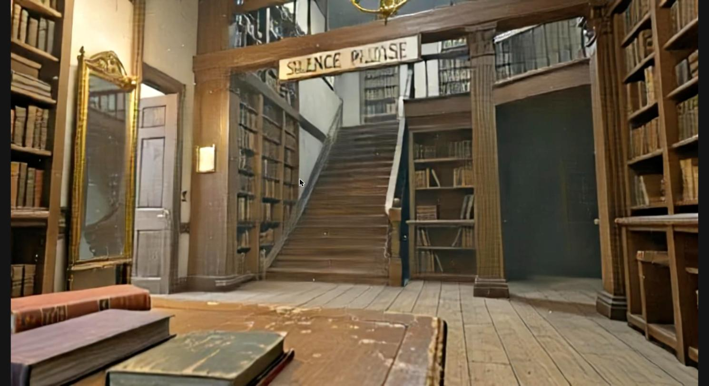

**Starship Bridge** (public preset). No weapon in view.
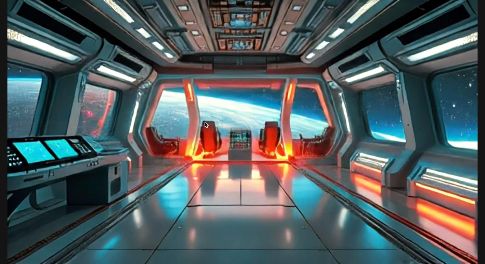

**Skyline Graveyard** (public preset). An empty gloved hand, no weapon.
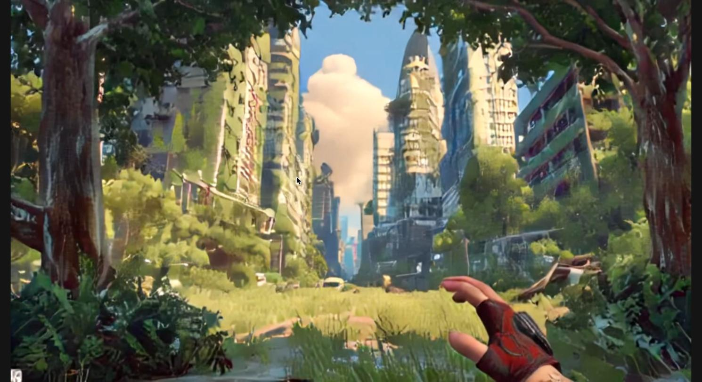

**Mistveil Keep** (public preset). A rifle in hand.
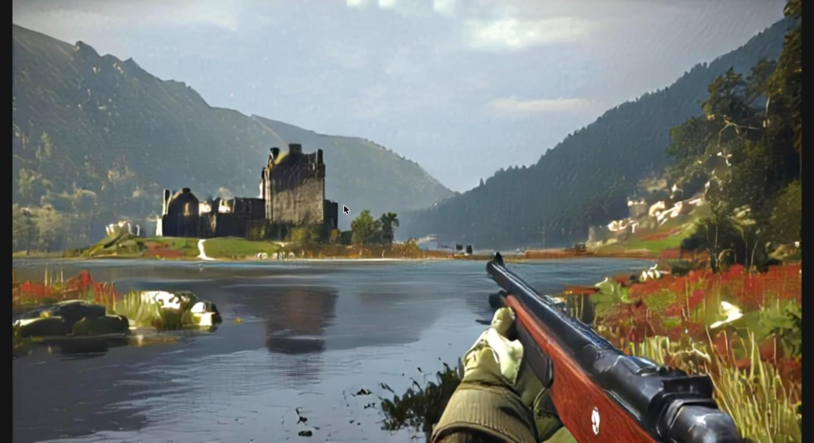

### Marble (viewer)
The side panel on each world shows the build steps: Text input, Pano (from world), Draft, World. Dragging the mouse turns the camera.

**Quiet Old Library Room.** The mirror shows a reflection-like image of the room (my guess is that it is baked into the scene, not a live reflection). The sign lettering is garbled and reads like "PKE ENNCE".
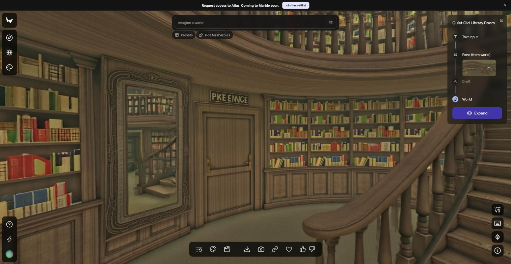

**Misty Medieval Castle Dawn.** The dock and the castle across the water match the prompt.
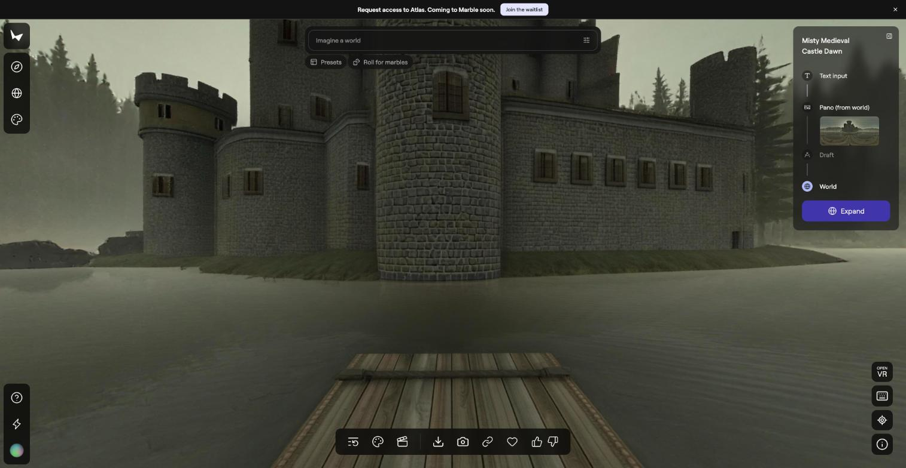

**Sci-Fi Starship Bridge Nebula.** A round viewport with a nebula, curved consoles with screens and two chairs.
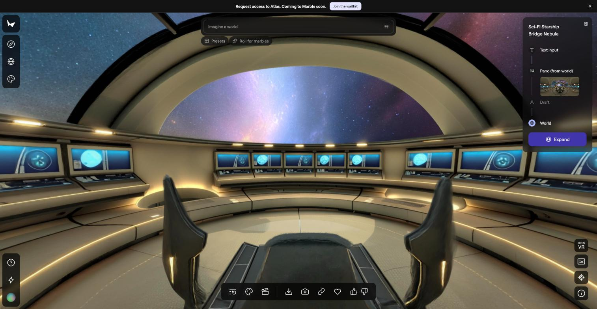

**Overgrown Ruined City Sunset, turn-around check.** Start view, then two turned views, then the view after pressing Return to origin. The same cars appear from different angles, and the last view matches the first exactly.

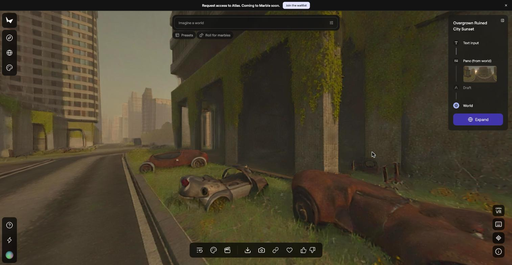
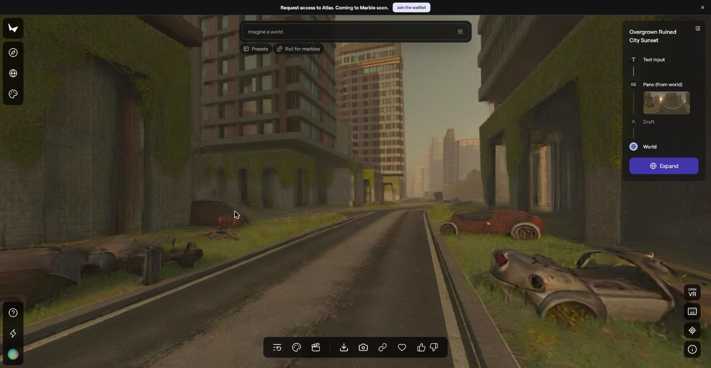
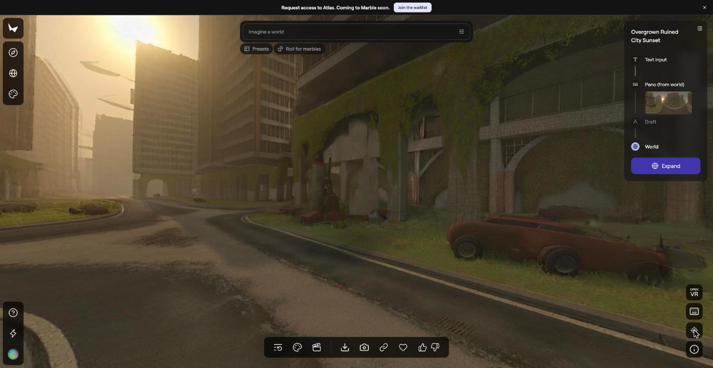

**Marble Share menu.**
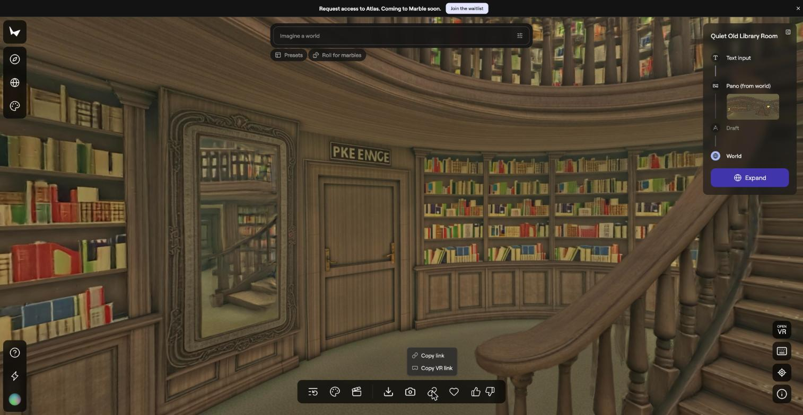

## Hands-on observations (reported by the user, 2026-11-02)
These come from the user's own testing. Claude did not check them in the Marble viewer or by playing Waypoint, and the notes do not say which worlds each one applies to. The per-world results table below is still blank.

1. **Marble worlds behave more like a Gaussian splat than a world model.** You look around a fixed 3D scene. Nothing in it responds to you.
2. **Waypoint worlds show many visual artifacts.**
3. **Waypoint does not remember where things are.** When you turn back, what you saw a moment ago has changed completely.

The research section further down explains why each of these happens.

## Test battery (run on every world)
1. **Turn-around:** does the space look the same after spinning around?
2. **Walk-away-and-return:** does it match when you come back?
3. **Doorway:** can you go through a door or opening?
4. **Mirror, stairs, text:** world 4 only. Does the sign still read "SILENCE PLEASE"? Does the mirror show a plausible reflection? Can you climb the stairs?

## Results log (fill in as you test)

| World | Tool | Turn-around | Walk-away-and-return | Doorway | Failures spotted | Recording |
|---|---|---|---|---|---|---|
| Castle | Marble | | | | | |
| Castle | Waypoint (Mistveil Keep) | | | | | |
| Starship | Marble | | | | | |
| Starship | Waypoint (Starship Bridge) | | | | | |
| Ruined city | Marble | Held: the same cars appear from both angles, and Return to origin restores the exact start view | | | | `marble-ruined-city-*.jpg` |
| Ruined city | Waypoint (Skyline Graveyard) | | | | | |
| Library | Marble | | | | Sign lettering garbled (reads like "PKE ENNCE") | `marble-library-viewer.jpg` |
| Library | Waypoint (Make World, text prompt) | | | | Sign lettering garbled; no weapon in view | `waypoint-library-live.jpg` |

## Research: Gaussian splats vs world models, and why the results look this way
Researched 2026-11-02 from vendor pages, model cards and a few papers. Sources are listed at the end.

### Two different things
- **Gaussian splatting** is a way to *represent* a scene. It stores the scene as a cloud of small 3D blobs (Gaussians) with position, shape, color and opacity. It can then be drawn quickly from any camera angle. It answers: "what does this scene look like from here?"
- **A world model** is a learned model that *predicts how the world changes* when you act. It answers: "what happens next if I do X?"
- They are not rivals. Research papers (for example Gaussian World Models and 4DGS-WAM) use splats as the scene state and renderer inside a learned model that predicts action-conditioned changes.

### Why Marble feels like a splat
- World Labs' own page says Gaussian splats are the highest-fidelity form of a Marble world. The other exports are meshes (collider and high-quality) and videos.
- The world is generated once, up front, as an explicit 3D scene. Here, the four worlds took several minutes to finish. After that you move a camera through fixed data.
- World Labs calls Marble "a generative world model," but its page presents interaction, where humans and agents act in the world, as a future goal. So the "world model" part is the generation step (text or image in, 3D scene out). Exploring the result is rendering.
- A fixed 3D scene is persistent, which is why turning around gives the same thing. The cost is that it is static and cannot react to you.
- Some regions can contain artifacts. World Labs says expanding a region can clean them up.
- World Labs has not published Marble's internal architecture. The details of how a prompt becomes a splat are not documented in what I could find. The viewer's side panel does show the steps for each world: Text input, then "Pano (from world)" with a 360-degree panorama thumbnail, then Draft (greyed out), then World. So a panorama appears to be made first and then built into the 3D world.

### Why Waypoint forgets and shows artifacts
- **It generates frame by frame.** Waypoint is a causal diffusion transformer. Each new frame is made from recent past frames plus your keys and mouse. There is no 3D scene stored anywhere.
- **Its memory is a rolling window.** Overworld says attention is causal and that its inference uses a rolling cache. The Waypoint 1.5 model card lists a 512-frame context. At 60 FPS that is about 8.5 seconds of video if those are video frames. The model compresses time 4x, so if they are latent frames it could be about 34 seconds. I did not confirm which, or which Waypoint model Overworld Stream runs. Either way, anything older than the window is gone, so when you turn back the model re-invents the scene.
- **The model card says so.** It warns that long rollouts may drift, collapse or become inconsistent, with unstable geometry and object-persistence failures. It also says the model is "not a simulator with guaranteed physical accuracy."
- **Errors pile up.** Overworld notes that frame-by-frame generation accumulates errors and that its training method (self forcing) is meant to reduce this. DeepMind says the same about Genie 3.
- **Speed costs quality.** Waypoint is distilled for real time, using a few denoising steps per frame, and the models are small (about 1.2B to 6B parameters) so they run on a consumer GPU. That is a plausible source of the artifacts, but the sources I read do not say so directly.
- **It was trained on game footage.** Waypoint-1 was trained on about 10,000 hours of video game footage with controls. That may explain why several of the presets show a held weapon. This is my inference. It is not stated by Overworld.
- **Genie 3 is the same kind of model.** DeepMind describes its consistency as emergent (not engineered), with visual memory reaching back about one minute, and contrasts it with approaches that use an explicit 3D representation such as NeRFs and Gaussian splatting.

### Side by side
| | Marble | Waypoint |
|---|---|---|
| What it produces | An explicit 3D scene (Gaussian splat, also meshes) | Video frames, one at a time |
| What it remembers | The whole scene, as stored data | Only a rolling window of recent frames |
| What you do | Move a camera through fixed data | Steer the next frame with keys and mouse |
| Return to a spot | Same, because it is the same 3D data | Not guaranteed. It can change completely. |
| When it is built | Up front. Several minutes here. | Live. The library world was ready in under 30 seconds. |
| Reacts to you | No | Yes, learned from game footage |
| Typical failures | Artifacts in some regions, static | Drift, forgetting, artifacts |

### What the field is doing about it
- **Add explicit memory.** A NeurIPS 2025 paper (Wu et al.) gives a video world model a long-term spatial memory: a point cloud of what it has already generated, plus recent frames and stored keyframes. They report better consistency when the camera returns to a place it has visited.
- **A different diagnosis.** A recent NVIDIA-linked preprint (WorldTrace) argues that unfamiliar positional encodings during long rollouts are a main cause of long-horizon failure, and stores "traces" of the scene to help recall.
- **Splats as the state.** The Gaussian World Model and 4DGS-WAM papers combine both ideas, with splats holding the persistent scene and a learned model handling the changes.

### Takeaway for the write-up
Each tool has the half the other lacks. Marble gives persistence without interaction. Waypoint gives interaction without persistence. A full world model would need both, which is what the memory and hybrid work above is trying to build. Whether Marble counts as a "world model" depends on the definition. By the "learned model that predicts what happens when you act" definition, its explorer is a renderer. World Labs does call it a generative world model.

### Caveats
- I could not read the Waypoint 1.5 paper (the file was too large to fetch), so context-length details come from the model card and Overworld's Waypoint-1 post.
- The Waypoint-1 post does not state the context length. The 512-frame figure is from the 1.5 model card.
- One blog claimed Marble uses NeRF and Gaussian splatting together. I found no primary source and left it out.
- The Wu et al. and WorldTrace results are from abstracts and excerpts. I did not check their numbers.

### Sources
- [World Labs: Marble, a generative world model](https://www.worldlabs.ai/blog/marble-world-model)
- [BD Tech Talks: World Labs and Marble](https://bdtechtalks.com/2025/09/19/world-labs-marble-generative-world-model/)
- [Scenario: Marble by World Labs, the essentials](https://help.scenario.com/articles/4774055514-marble-by-world-labs-the-essentials)
- [Overworld: Waypoint-1 on Hugging Face](https://huggingface.co/blog/waypoint-1)
- [Waypoint-1.5-1B-360P model card](https://huggingface.co/Overworld/Waypoint-1.5-1B-360P)
- [Google DeepMind: Genie 3](https://deepmind.google/discover/blog/genie-3-a-new-frontier-for-world-models/)
- [Video World Models with Long-term Spatial Memory (NeurIPS 2025)](https://proceedings.neurips.cc/paper_files/paper/2025/hash/467655d26fcc207bca08915dc91964c6-Abstract-Conference.html)
- [WorldTrace (NVIDIA)](https://research.nvidia.com/labs/sil/projects/WorldTrace/worldtrace_paper.pdf)
- [GWM: Gaussian World Models for Robotic Manipulation](https://arxiv.org/html/2508.17600v1)
- [4DGS-WAM](https://arxiv.org/pdf/2608.25956)

## Still to do
- [x] All four Marble worlds finished generating.
- [x] Credit balance confirmed: 680.
- [x] Opened each Marble world in the viewer and saved screenshots. On the ruined city, the same objects appeared from both angles and Return to origin restored the exact start view.
- [ ] Run the remaining tests by hand, in both tools.
- [ ] Play the three matching Waypoint scenes and Silent Library Balcony by hand (Mistveil Keep and the library load; Starship Bridge and Skyline Graveyard not yet opened).
- [ ] Install Biome on the 4080 PC and compare it with the browser version.
- [ ] Record screen captures (Shift-Cmd-5 on Mac; OBS or Xbox Game Bar on the PC).
- [ ] Fill in the results table and write the comparison.
