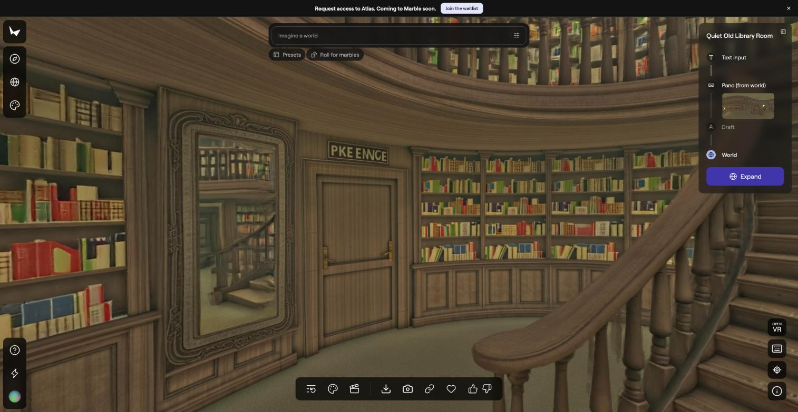
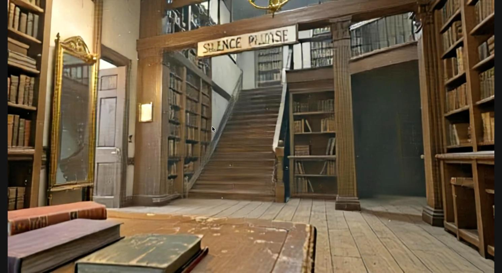
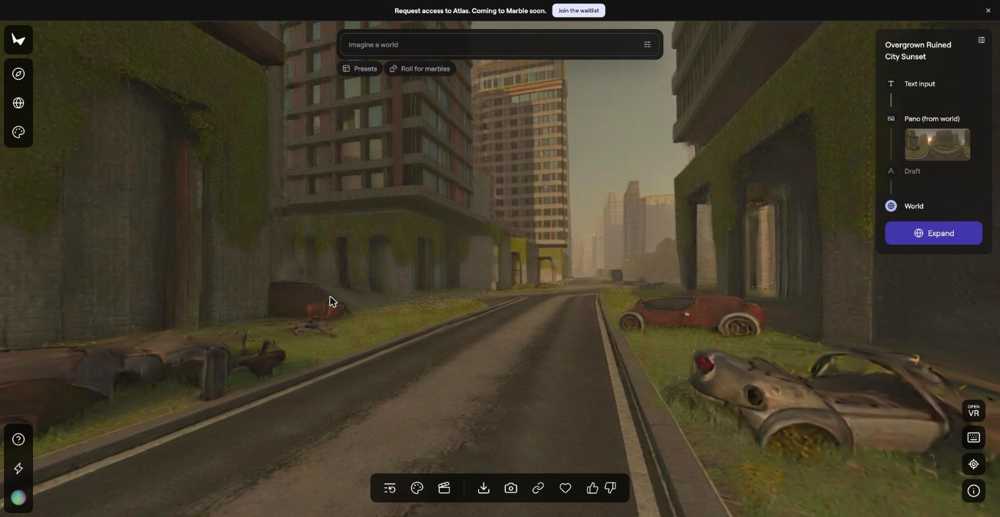
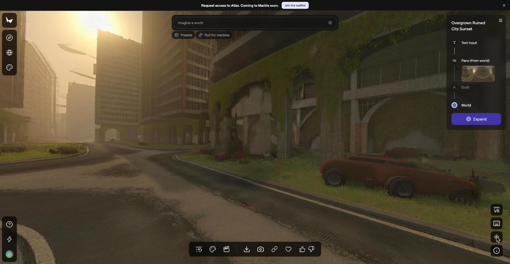
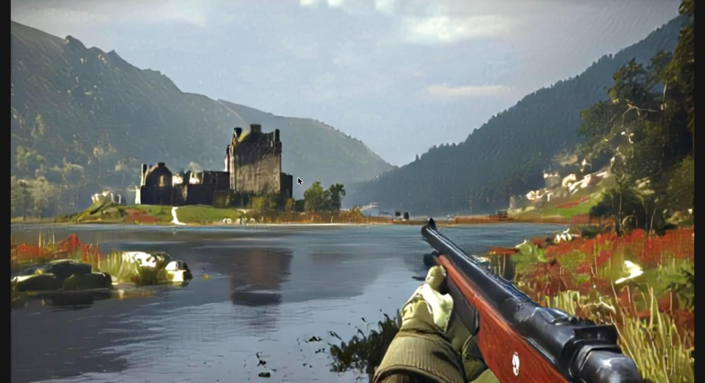

# Exploring AI World Models: Marble vs Overworld Waypoint

[Your name] · [Course] · November 2026

## Goal
I compared two kinds of AI-generated "worlds." One produces an explorable 3D world (Marble, from World Labs). The other produces a playable world in real time (Waypoint, from Overworld). The point was to try both, see where they fail, and see what each does well.

## Tools and setup
- **Marble:** takes text, images, video or a panorama and builds a 3D world. I used the free plan (7,000 credits, up to 4 world generations, no export) with the Marble 1.1 model. The faster Draft model is locked behind the $20/month Standard plan.
- **Waypoint** (Overworld Stream, in the browser): 19 public worlds plus a "Make World" box that takes a text prompt. Free with a sign-in. Overworld also offers a local app (Biome) for NVIDIA PCs, which is not part of these results.
- **Left out:** Google's Genie (paid Ultra plan, with the newest version limited to testers) and Runway's GWM-1 (application-only access). I wanted tools anyone could use tonight.

## What I made
I wrote four scenes and generated each in Marble from a text prompt.

| Scene | Marble world | Waypoint version |
|---|---|---|
| Misty castle on a lake | Misty Medieval Castle Dawn | Mistveil Keep (public preset) |
| Sci-fi starship bridge | Sci-Fi Starship Bridge Nebula | Starship Bridge (public preset) |
| Overgrown ruined city | Overgrown Ruined City Sunset | Skyline Graveyard (public preset) |
| Library with a mirror, stairs and a "SILENCE PLEASE" sign | Quiet Old Library Room | Silent Library Balcony (made from the same prompt) |

Only the library pair used the same prompt in both tools. The other three Waypoint scenes are Overworld's own presets, chosen because they were the closest match. The library was also the stress test, since mirrors, stairs and readable text are things these models often get wrong.

## Share links
- Waypoint, Silent Library Balcony (set to Unlisted, so only people with the link can open it): https://www.overworld.stream/e/m6iT8voo6Q3f
- Marble (the Share menu offers Copy link and Copy VR link):
  - Library: https://marble.worldlabs.ai/world/c4854aed-02e4-42e2-aa8d-fe6fd869682a
  - Castle: https://marble.worldlabs.ai/world/2080994c-6a4d-45f5-8433-d1de35d37be7
  - Starship bridge: https://marble.worldlabs.ai/world/969bc38b-3544-4871-847b-c77872c265cf
  - Ruined city: https://marble.worldlabs.ai/world/50b594dc-ab12-4ecf-af50-2a5fbcc99c98

[Check these in a private browser window before submitting. I have not tested whether they open for someone who is not signed in to my accounts.]

## What happened
**Marble.** Each world took several minutes to generate. The four used 6,320 of the 7,000 credits. Marble rewrote each short prompt into a long scene description and built the world from that. In my testing the worlds behaved more like a Gaussian splat than a world model: I could look around a fixed 3D scene, but nothing in it responded to me. The viewer shows each world was built in steps (text, then a 360-degree panorama, then the world). When I turned the camera in the ruined city, the same cars appeared from every angle, and pressing "Return to origin" brought back the exact starting view.

**Waypoint.** The library world was ready in under 30 seconds, and the public worlds loaded within about 10 seconds. I found many visual artifacts. More importantly, it did not remember where things were: when I turned back, what I had just seen had changed completely. Two of the presets I opened (The Hive Throne and Mistveil Keep) put a weapon in the player's hands. Starship Bridge, Skyline Graveyard and my library world did not.

**Both tools** garbled the lettering on the "SILENCE PLEASE" sign, so readable text was a failure in each.

[Add the results of the walk-away-and-return and doorway tests, and anything specific you saw on the library world, if you ran them.]

### Screenshots
The Waypoint screenshots are the first frames of each scene, not footage of walking or turning. More are in the `screenshots` folder.

**The library, Marble.** The mirror holds a reflection-like image of the room. The sign is garbled.

**The library, Waypoint** (same prompt). A similar layout with a garbled sign and no weapon.

**The ruined city, Marble.** Start view, a turned view, and the view after "Return to origin," which matches the start exactly.

**Mistveil Keep, Waypoint.** A public preset, with a rifle in hand.

## Why: Gaussian splats vs world models
A **Gaussian splat** is a way to store a scene, as a cloud of small 3D blobs that can be drawn from any angle. A **world model** predicts how the world changes when you act. They are different jobs, and recent research combines them.

| | Marble | Waypoint |
|---|---|---|
| What it produces | An explicit 3D scene (Gaussian splat) | Video frames, one at a time |
| What it remembers | The whole scene, as stored data | Only a rolling window of recent frames |
| Return to a spot | Same, because it is the same data | Can change completely |
| Reacts to you | No | Yes |

- **Marble:** World Labs describes Gaussian splats as Marble's highest-fidelity output and calls Marble a "generative world model," but it lists interaction as a future goal. So the world-model part is the generation step, and exploring is just rendering.
- **Waypoint:** it generates each frame from recent frames plus your keyboard and mouse, with no 3D scene stored. Its model card lists a 512-frame context, so anything older is forgotten. The card also warns that long rollouts can drift or lose objects, and Overworld says errors build up frame by frame.

## Takeaway
Each tool has what the other lacks. Marble keeps the world but cannot interact with it. Waypoint interacts but cannot keep the world. A full world model would need both, and researchers are working on it, for example by giving video models a spatial memory of what they have already generated.

## Reflection
Language models like Claude and ChatGPT have scaled so fast and become so good. The same is true of image generation models. Next to them, world models are still at a very early stage. In my testing, one tool kept a fixed world but could not respond to me, and the other responded but forgot what was behind me and showed many artifacts.

Still, I think it is definitely possible for world models to become as good as today's frontier language and image models. The research I read on giving video models a spatial memory suggests labs are already working on the problems I ran into. I am very excited to see what the frontier labs bring out next.

## Limits of this project
- I used free plans only, so Marble's Draft model and exports were unavailable.
- Three of the four Waypoint scenes were presets, not worlds made from my prompts.
- I do not know which Waypoint model Overworld Stream runs, so the context length is from the Waypoint 1.5 model card and may not match.
- Marble's internal design is not published, so the splat explanation rests on World Labs' own description of its outputs.
- Some research sources were abstracts and preprints that I did not check in detail.

## Process
[Optional, edit or delete: I used Claude (Claude Code with the Chrome extension) for research, planning, and to generate the worlds through my browser. I created the accounts and did the hands-on testing myself.]

## Sources
- [World Labs: Marble](https://www.worldlabs.ai/blog/marble-world-model)
- [Overworld: Waypoint-1](https://huggingface.co/blog/waypoint-1)
- [Waypoint-1.5 model card](https://huggingface.co/Overworld/Waypoint-1.5-1B-360P)
- [Google DeepMind: Genie 3](https://deepmind.google/discover/blog/genie-3-a-new-frontier-for-world-models/)
- [Video World Models with Long-term Spatial Memory (NeurIPS 2025)](https://proceedings.neurips.cc/paper_files/paper/2025/hash/467655d26fcc207bca08915dc91964c6-Abstract-Conference.html)
- [GWM: Gaussian World Models for Robotic Manipulation](https://arxiv.org/html/2508.17600v1)
